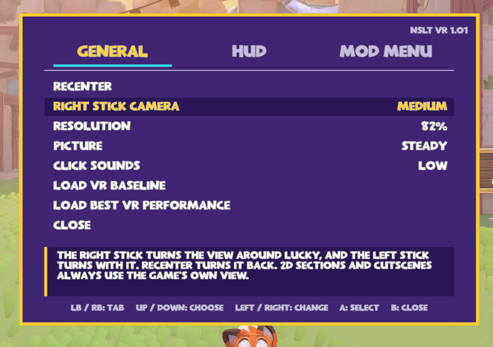
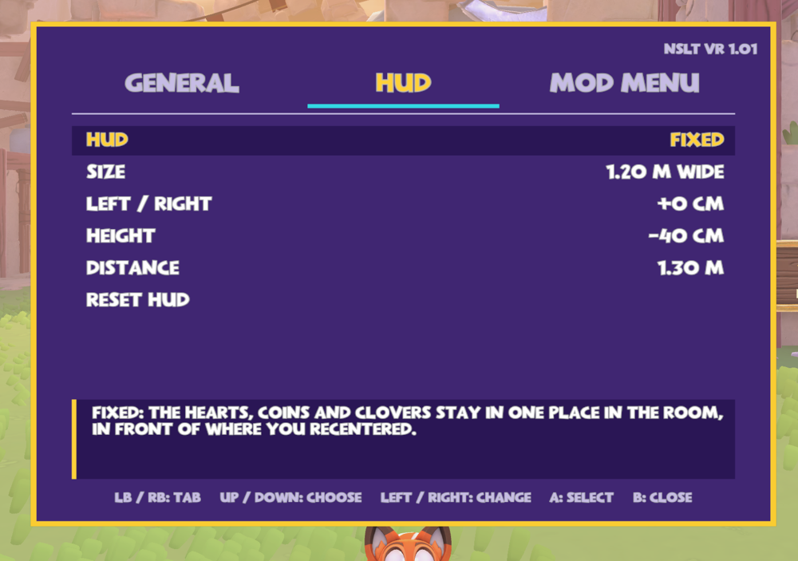
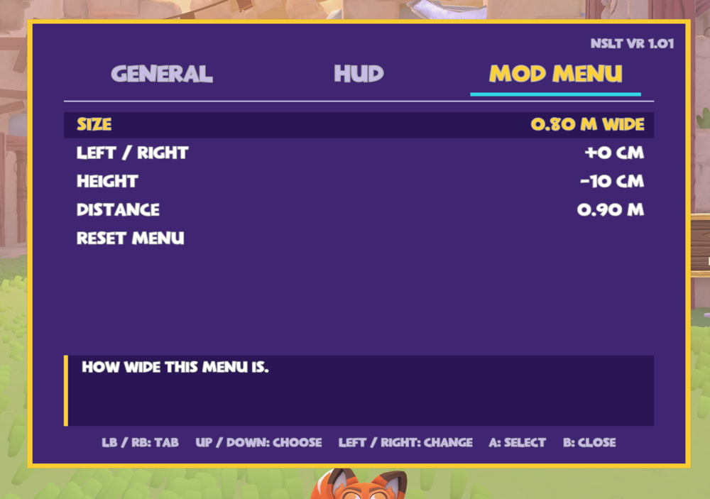

# NSLTVR

VR mod for **New Super Lucky's Tale** (Steam). The game runs on the VR camera it inherited from Lucky's Tale VR: each level is a toy world built around you, and Lucky runs through it in front of you. Native stereo, played seated with a gamepad.

**Download:** [NSLTVR-1.01.zip](https://github.com/scubasteve2365/NSLTVR/releases/latest) from Releases.

**Support:** if you enjoy it, you can [buy me a coffee](https://buymeacoffee.com/scubasteve2365).

- **Native stereo** through OpenXR: both eyes are drawn from the same game moment. No alternate-eye rendering, no warping.
- **The game's own VR camera.** New Super Lucky's Tale still carries Lucky's Tale VR's camera rig and per-level VR camera settings. The mod switches the game back to it.
- **Normal game speed at any headset rate.** The game keeps its 60 updates a second whether your headset runs at 72, 90 or 120 Hz.
- **HUD and menus in the headset**: hearts, coins and clovers on a panel, the pause book, dialogue, the costume shop, title and loading screens.
- **In-headset settings menu** in the game's own style. Hold both sticks for half a second, or press Insert.
- **One bat installer** that finds the game through Steam and uninstalls the same way. No game files are changed.

## What you need

- New Super Lucky's Tale on Steam
- A PC VR headset with an OpenXR runtime: SteamVR set as the OpenXR runtime, or Virtual Desktop's VDXR
- A gamepad. An Xbox pad is the standard. **PlayStation DualSense:** turn on Steam Input for the game (Steam, the game's Properties, Controller), so it shows up as an Xbox pad. The mod does not read a DualSense on its own.

## Install

1. Download `NSLTVR-1.01.zip` from Releases and unzip it anywhere.
2. Double click `Install NSLTVR.bat` and type 1. Windows may ask you to confirm, because the bat file is not signed. It is plain text if you want to read it first.
3. Start SteamVR or connect Virtual Desktop, then start New Super Lucky's Tale from Steam. VR starts by itself.

To uninstall, run the bat again and type 2.

## Settings

Hold both sticks down for half a second, or press Insert, to open the menu. LB and RB change tab, up and down choose, left and right change, A selects, B closes. Every row explains itself at the bottom of the menu. Settings save at once.

**General:** Recenter, Right stick camera (Off, Slow, Medium, Fast), Resolution (applies next start), Picture (Auto, Steady, Panel), Click sounds, Load VR baseline, Load best VR performance.

**HUD:** Fixed, Follows head or Hidden, plus size and position.

**Mod Menu:** where this menu sits.

## Game settings

The mod turns off VSync and the frame cap while VR runs (it paces the game to your headset itself), and turns off bloom and god rays, which look different in each eye. The game window on your monitor is 1920x1080 while VR runs.

**Load VR baseline** puts the game's display settings back to what the mod expects. **Load best VR performance** sets the Low preset (your texture quality is kept), no anti-aliasing and simple shadows; restart the game afterwards, because the gain only shows after a restart.

## Performance tips

1. In SteamVR, make sure per-app throttling and motion smoothing are off for this game.
2. Try Load best VR performance, then restart the game.
3. Lower Resolution in the General tab.

## Good to know

- Steam version only.
- No motion controls. A gamepad is required.
- The right stick turns the view around Lucky (new in 1.01, on by default, Medium speed). The game's own camera still does the following; the mod only turns your view, and the left stick turns with it. Recenter turns it back. 2D sections and cutscenes always use the game's own view. Turn it off in the General tab if you prefer the fixed Lucky's Tale VR view. Levels were built to be seen from the front, so from other angles you may see unfinished backs of scenery.
- Screens the game shows without its 3D camera (title, loading, the costume shop) appear on a big flat screen in front of you.
- No DLSS or other upscaler. The game is light and does not need one.
- Tested on a Pimax Dream Air through SteamVR at 72 Hz and a Meta Quest 3 through Virtual Desktop (VDXR) at 90 Hz, both with an RTX 5090. Other headsets should work through OpenXR but have not been tried. AMD and Intel graphics have not been tried.
- If the game stays flat, a "VR DID NOT START" message at the top of the screen says why. The log is `BepInEx\LogOutput.log` in the game folder; please attach it when you report a problem.

## Building from source

- Plugin (BepInEx 5, .NET 3.5): `dotnet build NSLTVR.csproj -c Release -p:GameDir="<your game folder>"`. It references the game's own assemblies from `nslt_Data\Managed` and BepInEx from the game folder, so BepInEx 5.4.23.6 x64 must be installed there first.
- Native DLL (OpenXR and Direct3D 11): CMake with Visual Studio 2022, x64 Release: `cmake -S native -B native/build -A x64 -DOPENXR_DIR=<Khronos OpenXR loader 1.1.65> -DMINHOOK_DIR=<MinHook source>`, then `cmake --build native/build --config Release`.
- Package: `python install/make_package.py <BepInEx x64 folder> <OpenXR loader LICENSE> <BepInEx LICENSE>`.

## Credits

By scubasteve2365. MIT licence. Uses BepInEx (LGPL-2.1), the Khronos OpenXR loader (Apache-2.0) and MinHook (BSD 2-Clause). The OpenXR side, frame pacing and the Steady picture mode come from [CupheadVR](https://github.com/scubasteve2365/CupheadVR) and [OriVR](https://github.com/scubasteve2365/OriVR); the Steady picture mode is based on a contribution by junglejuz. See [THIRD-PARTY-NOTICES.txt](install/THIRD-PARTY-NOTICES.txt).

This is a fan mod, not made or approved by Playful Studios. It contains no game files.
